# Taxi Morocco: итоговая проверка замечаний Валентина
31.10.2026 · код 7661d7c · проверка frontend

## Вывод
Не все замечания закрыты. Основные исправления frontend реализованы и проходят автоматические проверки. Полную готовность сервиса и пилота подтвердить нельзя: нужны серверные контракты, данные сервиса, документ конфиденциальности и приёмка на устройствах.

Проверены известные замечания из предоставленной переписки и локальных ТЗ PR, текущий код 7661d7c и опубликованный frontend. Нового полного экспорта Telegram в этом прогоне нет; сообщения вне этого списка не объявляются проверенными. Backend, БД и main не изменялись. Реальные заказы, регистрации и тесты нагрузки не запускались.

Из 42 пунктов: 26 закрыты в границах frontend; 11 частично; 5 открыты. Это классификация требований, не процент тестового покрытия.

## Тесты и пределы доказательств

- **Автотесты.** 709 из 709; 141 из 141 наборов. Ошибок нет.
- **TypeScript / production build.** Обе проверки прошли. Production build: Compiled successfully.
- **Граница backend-команд.** 229 core-файлов / 64 бизнес-обработчика совпадают с baseline; разрешённые frontend-отличия перечислены отдельно; неизвестных отличий нет.
- **GitHub #50.** OPEN / Draft, база review/18-approved-vehicle-icons; live Playwright E2E = SKIPPED. Это не результат реальных поездок.
- **Адаптивность формы.** 320×568, 360×640, 390×844, 768×1024, 844×390, 1440×900. DOM: нет горизонтального/страничного overflow, действия внутри viewport.
- **Дополнительные параметры.** 390×844, 768×1024, 1440×900 без внутреннего overflow; 320×568 и 844×390 - один доступный скролл содержимого, Готово закреплено.
- **Три режима / две роли.** 6 тестов threeJourneys для order/vote/offer: режим, цена, этапы, код посадки, отказ команды, восстановление, терминальные статусы и места. 8 свежих снимков показывают четыре этапа × две роли, в каждом - все три режима.
- **Ограничение CJM.** Экран QA read-only, кнопки команд inert/CSP. Снимки не являются кликабельным E2E. Завершение клиента - сводка результата FSM, не живая форма рейтинга.
- **Не выполнялось.** Серверные поездки; новый login/registration; реальный GPS/speech; физические Android/iOS; нагрузка 200-400; полный WCAG-аудит; аудит backend-безопасности.

## Все замечания

| № | Требование | Статус | Результат | Доказательство |
|---|---|---|---|---|
| 01 | Три способа заказа | Frontend закрыт | Сохранены order, vote, offer; прямые команды и отдельная справка. Тесты трёх сценариев прошли. | threeJourneys; RideRequestActions |
| 02 | Смысл Голосования | Frontend закрыт | Подсказка: еду на первом прибывшем такси. Не переименовано в сравнение предложений. | 12-booking-actions; cjm-client-offers.png |
| 03 | Vote вне города / отложенный | Frontend закрыт | Недоступный режим скрывается и проверяется повторно перед submit. Payload не подменяется. | orderFormResolvers.test.js |
| 04 | Offer: ввод своей цены | Частично | Проверка положительной цены и редактор есть. Успешный серверный контракт 150 → 180 не подтверждён; изменение публичной оферты после создания не считаем обязательным. | RideRequestActions; pilot/rules; cjm-client-offers.png |
| 05 | Несколько заказов клиента | Frontend закрыт | Три плашки сохранены. Нажатие QA-2 меняет выбранный заказ и адреса. Серверное создание нескольких поездок повторно не проверялось. | 09-client-multi.png; MiniOrders/switching.test.js |
| 06 | До шести заказов в Кратко | Frontend закрыт | На 390×844 видны все шесть карточек, тип заказа, цена и две метрики выгоды. | 10-driver-six.png |
| 07 | Два типа вызова / разная выгода | Frontend закрыт | Тип, сумма, выгода и выгода на км подачи разделены. Локальный расчёт сохранён; выбор фактической машины покрыт тестами. | profitPresentation; liveOrderProfit; boundary |
| 08 | Дорожный граф не fallback | Frontend закрыт | Граф остаётся основой локального расчёта доходности. Подготовка вынесена в Worker. Не заменён серверным API на каждый заказ. | graph/integration.test.js; 34-graph-cache |
| 09 | Кеш графа между сессиями | Frontend закрыт | Тесты открытия подготовленного IndexedDB-графа без повторного JSON-парсинга, проверки версии, повреждения, offline fallback и ошибки storage прошли. Свежий замер на телефоне не проводился. Свежий browser reload: IndexedDB, 69 892 узла, worker 16.0 ms, JSON/построение 0.0 ms, UI attach 0.2 ms. Это текущий компьютер. | graph/loader.test.js; graph/packed.test.js; graph-cache-after-reload.txt |
| 10 | Плавное движение машин | Frontend закрыт | Тесты retarget от текущего кадра, короткого поворота через север, шумов GPS и cleanup прошли. В браузерном fixture оба маркера изменили позицию; это синтетические координаты. | SmoothRotatingMarker.test.js; 11/12 screenshots |
| 11 | Восстановление поездки / мест | Frontend закрыт | Переходы, отказ команды при offline, восстановление активной поездки, освобождение мест после завершения/отмены покрыты тестами. Реальная серверная поездка в фоне не проверена. | threeJourneys; driverCapacity; sessionRecovery |
| 12 | Код посадки 000 вместо 111 | Частично | Frontend отвергает неверный код и не продвигает этап после ошибки gateway. Сервер обязан независимо проверять код; исключения эмулятора требуют контракта. | driverBoarding; DriverBoardingCommandPath |
| 13 | 5 минут у водителя / 15 у клиента | Открыто | Отсутствующее ETA не заменяется выдуманным временем. Авторитетное поле, единицы и синхронизация обеих ролей не подтверждены сервером. | pilot/rules; backend ETA contract |
| 14 | Заказы без флага эмулятора | Frontend закрыт | Принудительное обнуление списка без эмулятора удалено. Обычный polling и frontend-фильтрация проверены тестами. Реальные данные зависят от DB зоны Агадира. | readyOrdersPolling.test.js; boundary |
| 15 | Класс Petit / Grand / места | Частично | Frontend-фильтры и вместимость проверены. Серверное ограничение лицензии/географии/мест не доказано. Класс тестового водителя менять ради длинного маршрута не нужно: для Petit нужен короткий маршрут Агадира. | driverCapacity; orders selectors; backend filters |
| 16 | Полигоны и проверка зоны | Frontend закрыт | Статус проверки принадлежит конкретному адресу; устаревший/ошибочный ответ не разрешает submit. География сервиса не подменяется положением камеры. | zoneChecks; zoneCheck; API/polygon |
| 17 | Карта сначала показывает Аккру | Frontend закрыт | Начальная карта ограничена областью Марокко; в свежем опубликованном интерфейсе Аккра не появилась. Геопозиция вне региона не прижимается молча к границе. | 01-client-start-390.png; freshLocation/locationPolicy |
| 18 | GHS / +233 вместо Марокко | Открыто | Сервис продолжает отдавать GHS и +233. Это видно в настоящих параметрах и регистрации. Frontend не выдаёт эти суммы за MAD. Нужна согласованная конфигурация. | 02-options-390.png; 08-registration-390.png |
| 19 | Цвет машин по городу | Частично | Ливрея отделена от UI-палитры. Для подтверждённого Агадира применены красный Petit и бело-жёлтый Grand. Полный справочник остальных городов/зон не получен. | approved vehicle assets; 02-options-390.png |
| 20 | Разные силуэты классов | Frontend закрыт | Petit - компактный хэтчбек; Grand - высокий бело-жёлтый MPV по фотографиям Валентина. В карточках и на карте разные изображения, без круглого обрезания. | 02-options-390.png; cjm-client-offers.png |
| 21 | Одна палитра, красное лого | Frontend закрыт | Красный основной, чёрный/белый, рыжие акценты. Переключателя палитр нет. Лого рядом с меню, GPS рядом с языком. | 01-client-start-390.png |
| 22 | Карта закрыта адресами при откликах | Frontend закрыт | Адреса свёрнуты в Маршрут, отклики компактны, нижние действия доступны. Карта и движение двух машин видны. | 11-client-responders-map.png |
| 23 | Обрезанные машины / синяя точка | Frontend закрыт | Artwork сохраняет пропорции; голубая точка заменена подписанной легендой линии маршрута. Эта линия не означает цвет кузова. | 11-client-responders-map.png; cjm-client-offers.png |
| 24 | From/To, центр карты, fullscreen | Frontend закрыт | Подать сюда / Ехать сюда используют точку под меткой. Fullscreen и Escape предусмотрены; mobile +/- скрыты. Операции точек не меняют контракт заказа. | 14-map-controls; map interaction tests; 04-map-picker-390.png |
| 25 | GPS при старте / повторный запрос | Частично | Один стартовый preflight; prompt/granted вызывает запрос, denied не зацикливает его. Явная кнопка запрашивает свежие координаты, timeout 10 с. Denied → карта проверено. Системное окно и успешный GPS на физических устройствах не проверены. | freshLocation.test.ts; 03/04 screenshots |
| 26 | Нижняя пустая полоса выбора точки | Frontend закрыт | В актуальном снимке 390×844 подтверждение внутри экрана, большого пустого блока снизу нет. Карта использует высоту viewport. | 04-map-picker-390.png |
| 27 | Параметры / скачки / прокрутка | Frontend закрыт | Основные команды внутри viewport на шести размерах. В параметрах на 390×844, 768×1024, 1440×900 нет scroll overflow. На 320×568 и 844×390 одна прокрутка содержимого, Готово закреплено. | viewport-results.json; options screenshots |
| 28 | Локализация через БД | Частично | Приоритет текстов сервиса и lang/dir работают. RU → FR → AR проверены, RTL без горизонтального overflow. Но встречаются Name, Hint..., Waiting, Expand map; перевод всего сервиса не закрыт. | localization/locale; 05/06 screenshots; registration snapshot |
| 29 | Адрес на трёх языках | Частично | Frontend выбирает name:locale при наличии метаданных. Без них сохраняет исходное имя и координаты; гарантировать один язык адреса для всех данных нельзя. | addressPresentation; geocoder metadata |
| 30 | Язык голосового ввода / PR #41 | Частично | Язык передаётся в наш voice channel; смена языка отменяет сессию. Защита от stale geocode, повторных результатов и отрицательного подтверждения покрыта тестами. Реальный микрофон, речь и WebView не проверены. Аудиопересказ браузера не управляется приложением. | BrowserVoiceChannel; PassengerVoiceAssistant tests |
| 31 | Вход / регистрация | Частично | Диалоги открываются, поля доступны в одной прокручиваемой области. Длинная форма водителя сохраняет обязательные поля. Регистрация и активация новым backend аккаунтом в этом прогоне не выполнялись. | 08-registration-390.png |
| 32 | Аноним из свободного пула | Открыто | Есть отдельное локальное demo без регистрации. Выдача свободного тестового аккаунта, эксклюзивность, pool busy, heartbeat/TTL и release не реализованы без серверного контракта. Не выдаём demo за общий пул. | investor demo; backend guest lease |
| 33 | Выдуманные 7 машин / 5 минут | Frontend закрыт | Постоянные рекламные значения не считаются реальной доступностью. Тестовые суммы и машины в fixture явно подписаны. Настоящий count/ETA должен дать сервер. | rideData/pilot; local fixture labels |
| 34 | Выполнение JavaScript из данных / 0 и false | Frontend закрыт | Безопасный арифметический парсер вместо eval; HTML sanitize, сериализация 0/false и session isolation покрыты тестами. Это не аудит безопасности backend. | security/arithmetic,html,formData,sessionTokens |
| 35 | CI на общем тестовом сервере | Частично | Draft live E2E выключен. В свежем #50 Playwright E2E = SKIPPED, не PASS. Unit/TS/build проверены локально. Изолированного стенда и проверки конкурентных live workflow нет. | 31-ci-live-gate; PR #50 status |
| 36 | Редактор зон / отдельный map repo | Частично | Frontend обвязка и тесты модели/редактирования/отмены есть; боевые зоны в ходе аудита не записывались. Права и конкурентное сохранение проверять на стенде. | admin/zones tests; 39-zone-editor |
| 37 | 200-400 водителей / реальные телефоны | Открыто | Нагрузочный тест, Android/iOS на улице, background/foreground и восстановление реальной поездки после потери сети не выполнены. 709 unit/regression тестов не заменяют эту приёмку. | No isolated backend; mobile acceptance gate |
| 38 | Политика конфиденциальности - новое | Открыто | Публичная ссылка privacy_policy_ru.docx отвечает 200 text/html (SPA), а не DOCX. Два других документа отдаются корректно. Нужен утверждённый документ владельца сервиса и проверка ссылки после добавления. | HTTP content-type/signature checked 31.10 |
| 39 | Меню и тестовая позиция карты | Frontend закрыт | По ТЗ 31.10 09:20/09:26 выбор города находится в Для тестирования. Он меняет камеру, не рабочую географию. Требование удалить эмулятор и журналы в этом пункте не зафиксировано. | 14-map-controls.md; graph-cache-after-reload.txt |
| 40 | Синяя машина вместо сгенерированной | Frontend закрыт | Найден и исправлен выбор общей синей UI-темы как ливреи в анимации Casablanca. До городской конфигурации используется красный Petit и утверждённый PNG; отдельные city/class overrides сохранены. Старый SVG из карточки демонстрации убран. | taxiPalette regression; 14-generated-taxi-and-passenger.png |
| 41 | Странный альбомный адаптив | Frontend закрыт | Исправлена общая ширина формы и настоящего слоя карты. На 844×390 карта 381 px, форма 439 px, кнопки не пересекаются. Проверены также 667×375 и 912×412; класс в summary сохранён. Fullscreen 844 px / Escape проверены. | 13-landscape-fixed-844x390.png; landscape results |
| 42 | Иконка пассажира | Frontend закрыт | Вместо детализированной фигурки - компактная SVG-иконка: чёрный силуэт, красный акцент, белая подложка. Версионированный asset заменён в общем источнике, координаты и поведение маркера не менялись. | public/maps/passenger-v2.svg; 14-generated-taxi-and-passenger.png |

## Приёмка backend и данных

| Приоритет | Задача | Условие приёмки |
|---|---|---|
| P0 | Код посадки | Обычная поездка с 000 вместо 111 не начинается ни через UI, ни прямым API. Исключения эмулятора описаны и изолированы. |
| P0 | Контракт Offer | Дать успешные request/response: короткий городской маршрут Агадира, клиент 150, водитель 180, принятие и завершение. У обеих ролей одинаковая сумма/режим; описать поведение нулевой цены и неизменность оферты. |
| P0 | ETA | Назвать поле/единицы. Выбранные водителем 5 минут одинаково видны клиенту после polling/reload. |
| P0 | Лицензии / зоны / вместимость | Сервер не выдаёт и не принимает неподходящий заказ для Petit/Grand, зоны и количества мест. Frontend-фильтр не авторизация. |
| P0 | Изолированный стенд | Выделить тестовый tenant/аккаунты и повторяемые данные. Пройти три режима с двух ролей, повтор завершений/отмен и восстановление после disconnect. |
| P1 | Настройки и контент | Согласовать MAD/+212/зону, переводы и name:locale, полную таблицу ливреи (зона, класс), реальные count/ETA. Утвердить и передать документ privacy_policy_ru.docx. |
| P1 | Гостевой пул | Атомарно занять свободный аккаунт на роль; один гость на учётку; отказ при исчерпании; heartbeat/TTL/release; сохранить метки тестовых заказов. Пароли не помещать в frontend bundle. |
| P1 | Пилот / устройства | Согласовать p95, частоту polling/socket и допустимую долю ошибок; проверить 200-400 водителей, Android/iOS, GPS, микрофон, фон, сеть и восстановление. Выполнять на стенде. |

## Свежие экраны и наблюдения

### 01. Открытие и основные действия
В порядке: красный логотип, GPS рядом с языком, понятные подписи, кнопки не обрезаны. Неактивность при пустом маршруте ожидаема.
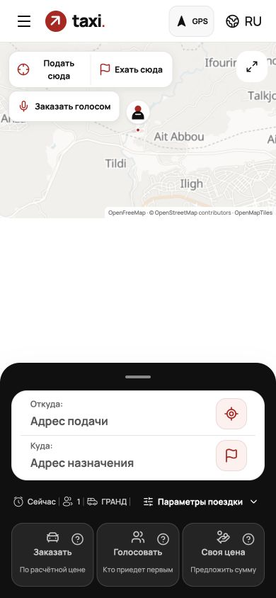

### 02. Параметры поездки
Все поля сохранены, кузова различаются. На обычном телефоне помещаются; GHS/+233 остаются открытой конфигурацией.
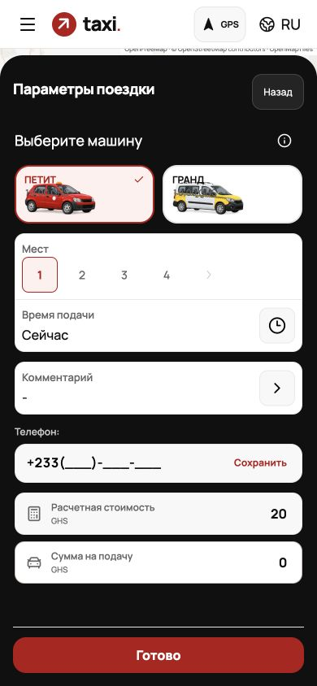

### 03. Отказ геопозиции
Понятны повтор запроса, выбор на карте и инструкция. Сайт не обещает сам снять запрет браузера.
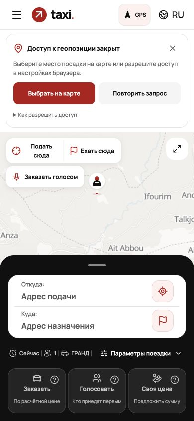

### 04. Выбор точки посадки
Карта видна, красная кнопка внутри viewport; прежней большой пустой полосы снизу нет.
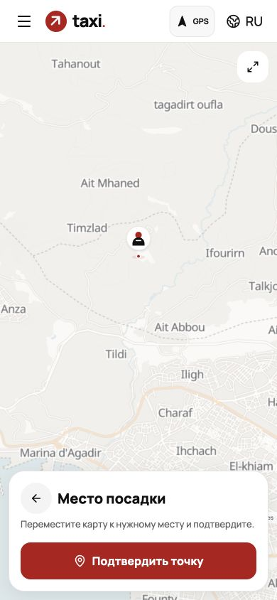

### 05. Смена языка
Французский интерфейс, GPS сохраняется. Остались отдельные тексты сервиса на другом языке.
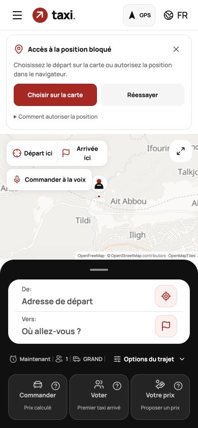

### 06. Арабский интерфейс
RTL применён, горизонтального overflow нет. Полную корректность арабских формулировок носителем языка не проверяли.
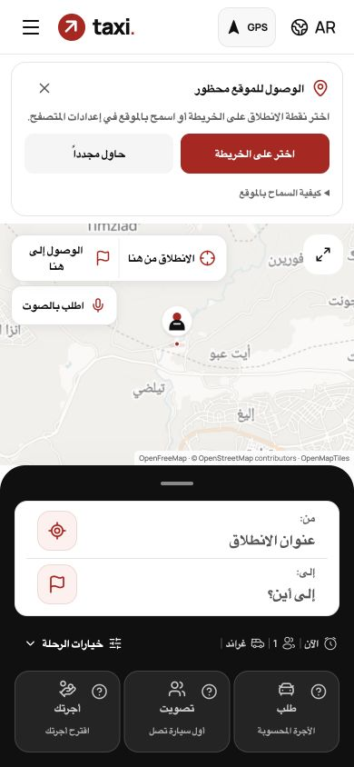

### 07. Водитель без авторизации
Заказы защищены входом. Нельзя считать это проверкой рабочего авторизованного backend-экрана.
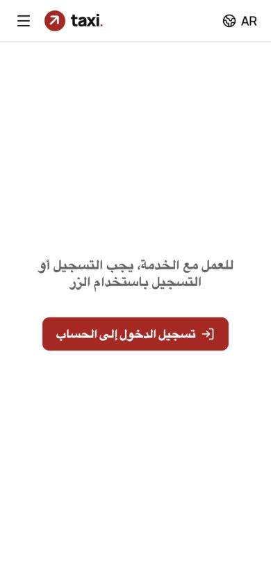

### 08. Регистрация водителя
Форма открывается и прокручивается; обязательные поля сохранены. Есть неполные переводы и отсутствующий документ. Без отправки данных.
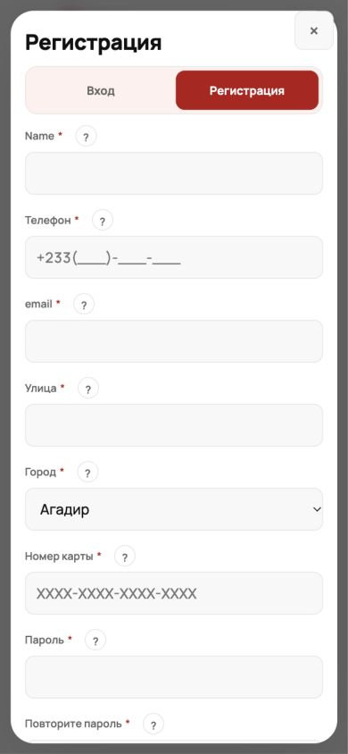

### 09. Несколько заказов
Нажатие QA-2 переключило плашку и адреса. Настоящий MiniOrders на локальных данных.
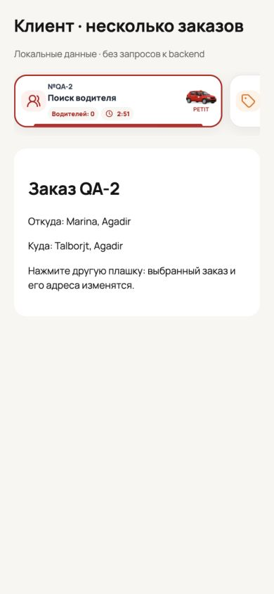

### 10. Кратко у водителя
Шесть карточек полностью видны на 390×844, суммы/тип/выгода разделены.
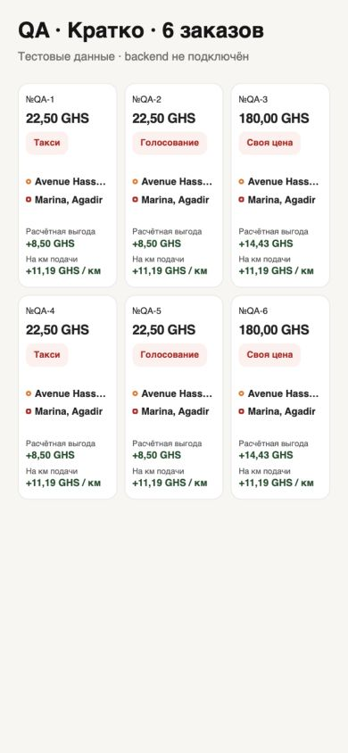

### 11. Карта откликов
Карта занимает большую часть экрана, адреса свёрнуты, кнопка выбора и нижние действия видны.
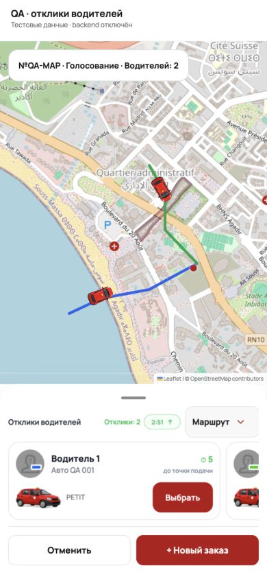

### 12. Движение к посадке
Позиции обоих маркеров изменились. Это синтетическое движение; качество реального GPS и производительность телефона не доказаны.
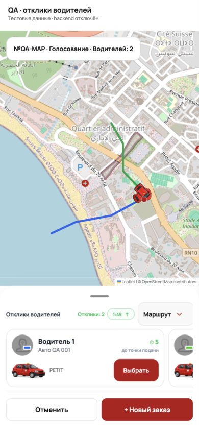

### 13. Альбомный адаптив после исправления
Карта и форма теперь имеют согласованную ширину. Кнопки не заходят на форму, класс и действия видны.
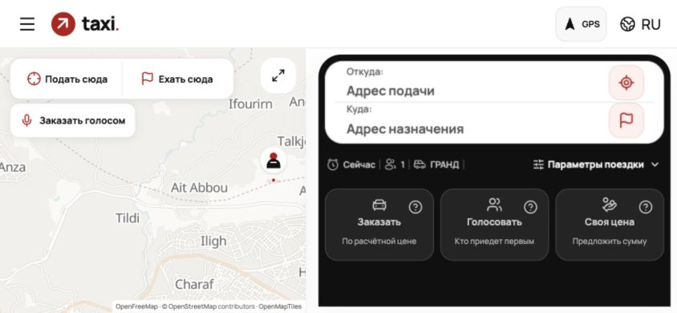

### 14. Маркеры и анимация
Используется сгенерированный красный Petit и компактный пассажир. Управление анимацией не перекрыто кнопками установки адресов.
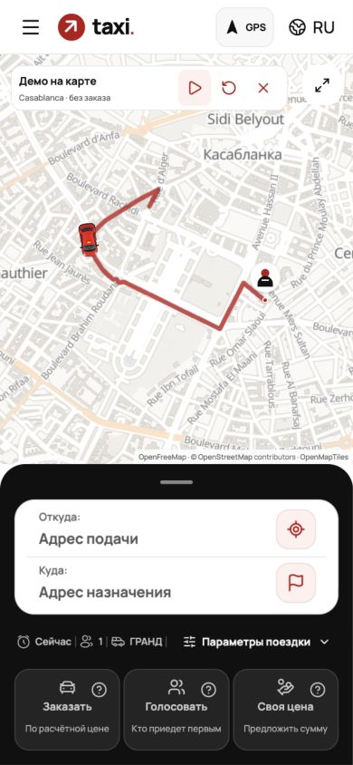

### 15. Кеш графа после reload
Источник indexeddb, 69 892 узла; worker 16.0 ms; JSON/построение 0; UI attach 0.2 ms.
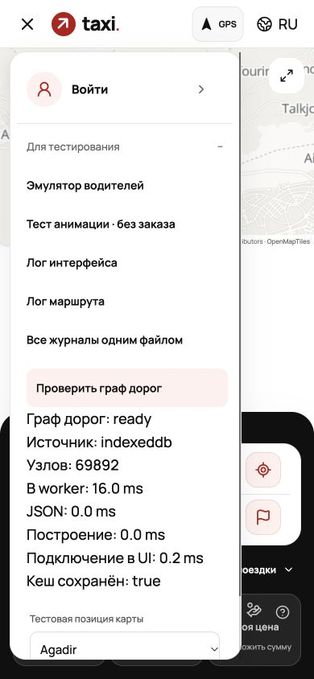

## CJM: три типа поездки с двух сторон

Каждый снимок содержит обычный заказ, Голосование и Свою цену. Состояния подставлены из локальных ответов. Команды не выполняются; реальную синхронизацию и завершение на сервере это не доказывает.

### Клиент: Отклик
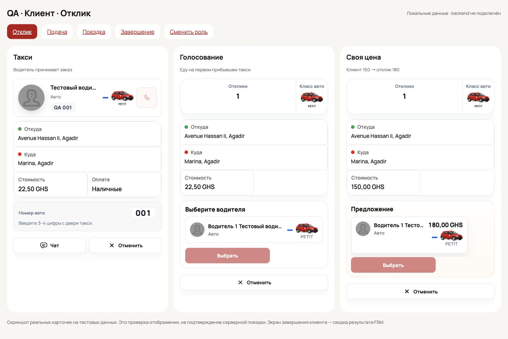

### Клиент: Подача
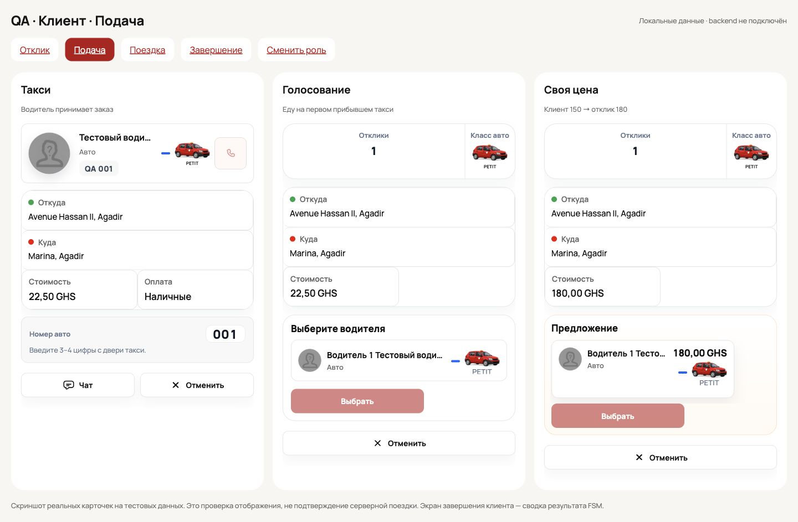

### Клиент: Поездка
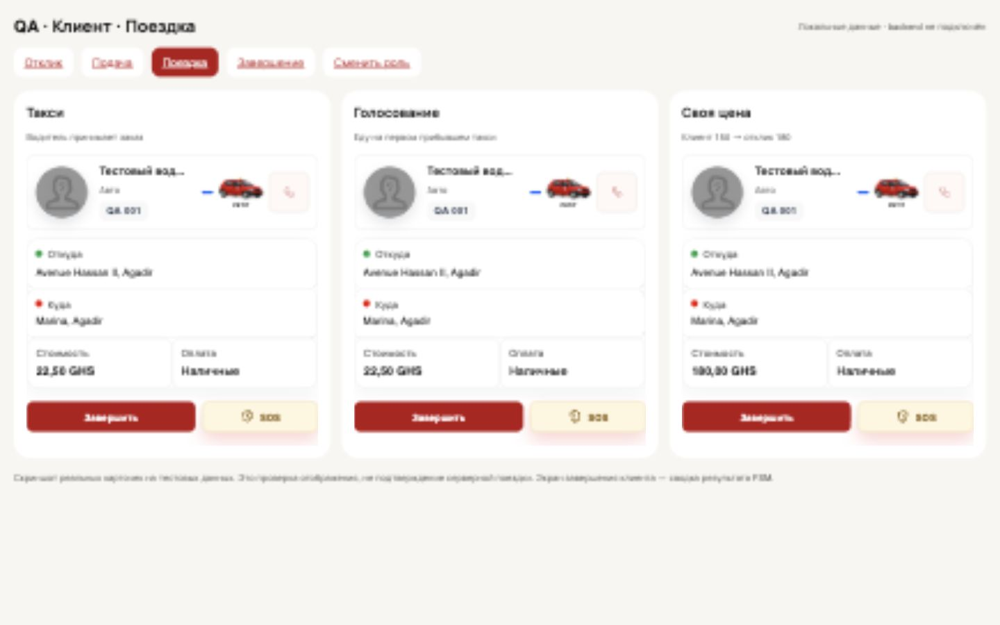

### Клиент: Завершение
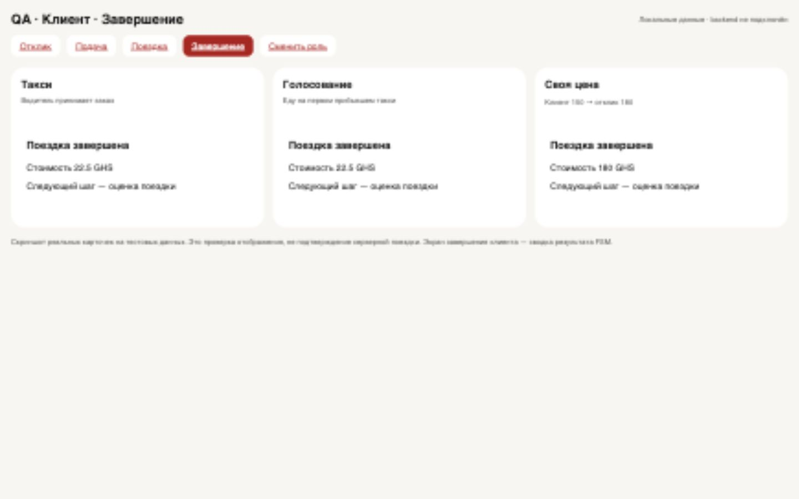

### Водитель: Отклик
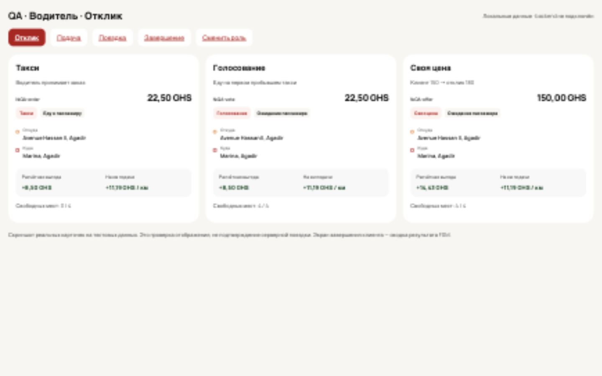

### Водитель: Подача
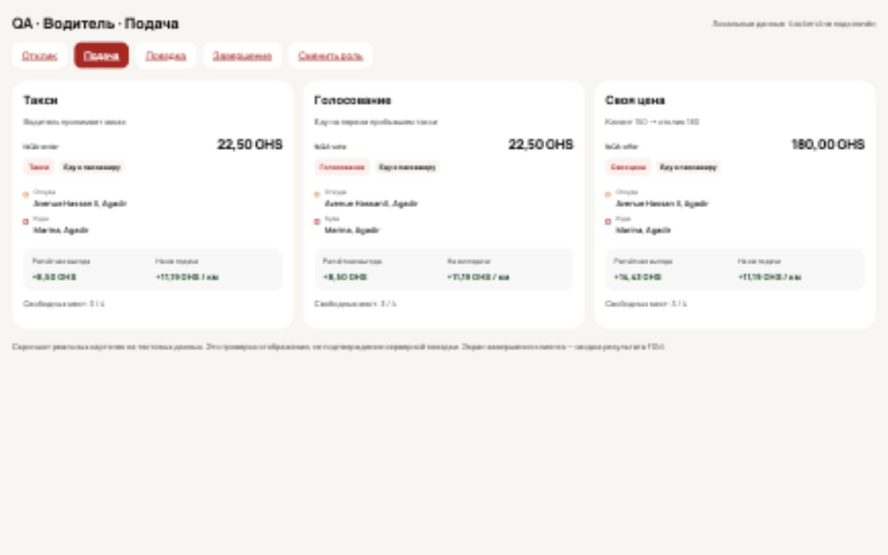

### Водитель: Поездка
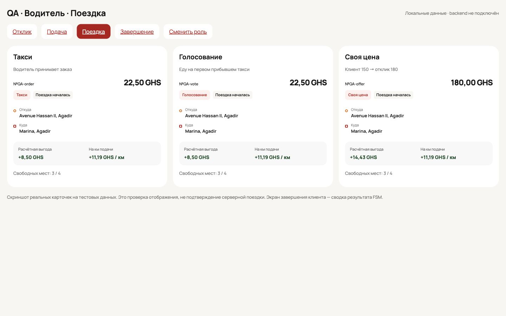

### Водитель: Завершение
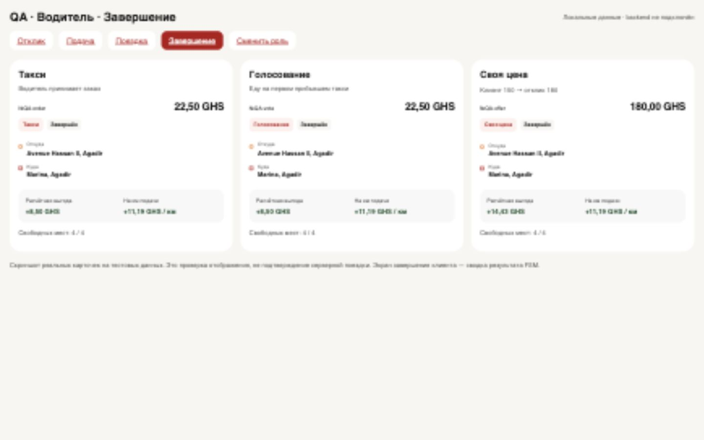

## Что означает готовность на текущем этапе

Frontend можно передать Валентину на review. Нельзя объявить закрытыми все требования и готовность пилота до серверной приёмки, исправления данных/документа и прогона на реальных устройствах. В этом аудите исправлены ливрея тестовой анимации, её перекрытия, альбомный адаптив и иконка пассажира. Backend, БД и main не менялись.

## Ссылки и исходные материалы

- Публичный клиент: https://taxi-morocco-frontend.vercel.app/passenger-order
- Публичный водитель: https://taxi-morocco-frontend.vercel.app/driver-order
- Draft PR: https://github.com/Guseyn9/taxi/pull/50
- Известные комментарии: ../VALENTIN_COMMENTS_20261030.md
- ТЗ по PR: ../../pr-specs/README.md
- Результаты и hash полного локального лога: results.json
- DOM-замеры: viewport-results.json
- Снимки CJM и статусы: journey-snapshots.json

Старые отчёты и замеры кеша не выдаются за свежие результаты этого прогона. Полный лог сохранён локально, персональные данные и пароли в отчёт не включены.